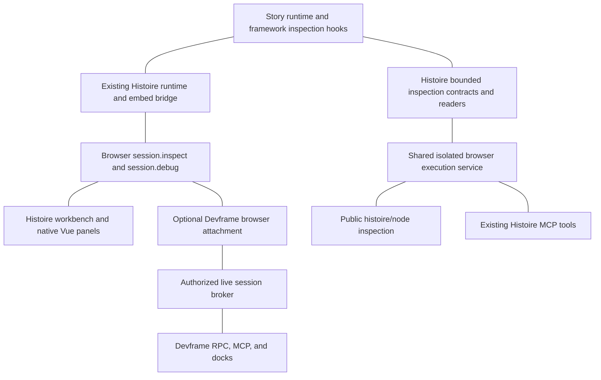

# Architecture and repository seams

## Current verified baseline

- [MCP reference](../../docs/reference/mcp.md): four rendered inspection tools already use fresh isolated mounts, operation admission, polling, cancellation, and 60 KiB result bounds. ARIA snapshots are not axe audits.
- [Browser SDK](../../packages/histoire-sdk/src/types.ts): state, selection, events, source, tests, and application channels are public; inspection is absent.
- [Node SDK](../../packages/histoire/src/node/api/types.ts): project lifecycle, tests, and screenshot capture are public; inspection is absent.
- [Runtime state service](../../packages/histoire/src/node/virtual/preview-runtime/runtime-service.ts) imports getter-safe projection from an MCP-specific module. Isolated authority currently includes document ID, nonce, epoch, story, and variant.
- [Element inspection](../../packages/histoire/src/node/virtual/preview-runtime/element-inspection.ts) supports picking/measurement, selectors, and geometry inside the runtime.
- [SDK request ownership](../../packages/histoire-sdk/src/session/request.ts) captures source and runtime ownership and checks it again after settlement.
- [Embed dispatch](../../packages/histoire-app/src/embed/commands.ts) enforces source publication and cross-origin policy. [Bridge types](../../packages/histoire-protocol/src/bridge/types.ts) enumerate finite commands/events.
- [Isolated task](../../packages/histoire/src/node/mcp/browser/inspection/task.ts) combines variant projection, DOM, Playwright ARIA, and startup diagnostics. Generic browser execution already lives under `node/runtime/browser/`.

## Layering

Edges express dependencies/data paths, not ownership transfer. Devframe connection lifetime never owns the supplied Histoire session/project. No implementation may read iframe DOM from the external SDK host.

## Two execution modes

**Live:** read existing ready document and exact rendered target. Preserve user state, animation, clock, viewport, and environment. No browser launch, remount, implicit selection, or hidden runtime. Return evidence observed during a bounded interval; multiple DOM/state reads are not an atomic transaction.

**Isolated:** mount exact target in owned Chromium context through existing execution lane. Preserve current determinism settings and lifecycle. Node SDK returns completed result; existing MCP returns retained operation handle. Browser-only APIs must not pretend they can obtain Playwright's ARIA snapshot or network telemetry.

## Shared extraction

Move portable state/DOM readers to new `packages/histoire-shared/src/inspection/`, with browser-safe exports and pure JSON contracts in `@histoire/protocol`. Move isolated task/diagnostics orchestration to `packages/histoire/src/node/runtime/inspection/`. Leave compatibility re-exports at existing MCP paths while updating imports. MCP parsing/envelopes/retention stay in `node/mcp/`.

Use existing screenshot task/session, cancellation, deadline, diagnostics sanitization, execution owner, and Node source acquisition patterns. Extraction must preserve source evaluation requirements for functions embedded with `.toString()` or `page.evaluate`; do not introduce free-variable dependencies into emitted readers.

## Devframe package

New `packages/histoire-devframe` publishes `@histoire/devframe/client`, `/node`, and `/types`. Client imports only browser-safe Devframe and Histoire APIs. Node entry owns definition, broker, agent registrations, and hosting glue. Core packages never import this adapter. Host chooses whether to install inspector/a11y/dock packages; their UI is not bundled into core SDK.

One adapter service descriptor registry supplies RPC and live MCP bindings, including schema, required capability, action/read classification, and handler. It calls SDK/public Node operations; no duplicate inspection algorithms. Existing MCP keeps its strict schema/envelope adapter over shared isolated services.

## Component and accessibility extensions

Framework hook provides component tree, component details, and element ownership. Vue adapter owns Vue internals and feature detection. Generic projection never serializes component instances or executes getters. Source locations are project-relative verified references; opening an editor goes through existing source policy.

Axe scanner runs inside selected story document, not workbench shell. Histoire owns result normalization and lifecycle. Devframe's a11y add-on may consume that service through an adapter if its pinned API permits; do not run a second independent scanner to imitate its UI. Browser SDK and isolated Node service share scanner semantics. Existing ARIA tool remains unchanged.

## Hosting choices

- Standalone Histoire: opt-in adapter endpoint mounted under book base; native workbench uses SDK directly.
- Custom SDK host: explicitly attach already-created session; host owns its Devframe connection and pairing bootstrap.
- Vite/Nuxt DevTools: adapter definition/dock mounts into host-owned hub. No global page-script context replacement.
- Static book: optional local inspection runs in instrumented document; no network MCP backend appears automatically.
- Static report: explicit bounded snapshot export through Devframe build support; carries historical identity/time and exposes no live mutations.

Unresolved upstream API details are bounded by slice 01 compatibility probes, not delegated as architectural choices to every slice. Pin tested versions; official pages currently show inconsistent version badges and legacy experimental language.
